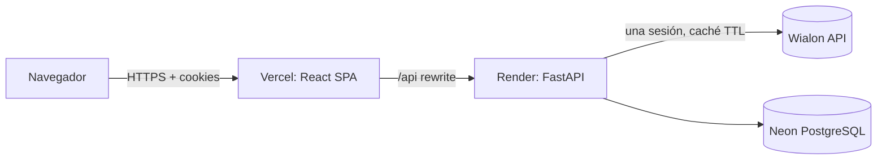

# Wialon Fleet Control

Plataforma web de gestión de flota sobre la API de **Wialon**: vehículos en mapa en tiempo casi real, conductores, pasajeros, historial de recorridos con reproducción, dashboard, usuarios con roles y auditoría.

Prueba técnica **Fullstack Junior — GPS Control**. Backend **FastAPI (Python)** + frontend **React + TypeScript (Vite)**.

| | URL |
|---|---|
| **Aplicación (frontend)** | https://wialon-fleet-control.vercel.app |
| **API (backend)** | https://wialon-fleet-api.onrender.com |
| **Documentación de la API (Swagger)** | https://wialon-fleet-api.onrender.com/docs |

> **Credenciales Admin:** se entregan por el canal privado de la prueba (nunca en el repositorio).
> **Arranque en frío:** el backend está en el plan gratuito de Render y se duerme tras inactividad. La primera petición puede tardar ~1 min; la app lo detecta y muestra un aviso mientras despierta el servidor (reintentos con backoff, DEP-04).

---

## 1. Funcionalidades implementadas

| Módulo | Qué hace | Requisitos |
|---|---|---|
| **Landing + login** | Página pública, inicio de sesión con cookies seguras, aviso de servidor despertando | RF-01..05, DEP-04 |
| **Usuarios y roles** | Solo el Admin crea usuarios; contraseña temporal + **cambio obligatorio** en el primer acceso; activar/desactivar, cambiar rol, restablecer contraseña (revoca sesiones). Admin inicial sembrado desde variables de entorno | RF-06, RF-07 |
| **RBAC** | 3 roles (Administrador, Operador, Visualizador) con **13 permisos granulares** en BD; los endpoints exigen permisos, no `if role == "admin"`. El menú se filtra por permisos | RF-07, TST-02 |
| **Dashboard** | KPIs y gráficas (estado de la flota, vehículos con/sin conductor) | RF-23 |
| **Vehículos** | Lista paginada con búsqueda y filtro por estado, mapa Leaflet con **clustering**, sincronización lista ↔ mapa, polling cada 15 s **pausado con la pestaña oculta**, detalle con conductor, pasajeros y campos personalizados | RF-10..15 |
| **Conductores** | CRUD reflejado en Wialon + asignar/desasignar vehículo | RF-16..18 |
| **Pasajeros** | CRUD (tags de Wialon) con campos personalizados **sin pérdida de datos** + asignación a vehículo | RF-08, RF-09, RF-27, RF-28 |
| **Historial** | Recorrido de un vehículo por rango (máx. 7 días, hora Bogotá) en el mapa, estadísticas (distancia, vel. máxima, tiempo en movimiento) y **playback** (reproducir/pausar, x1/x4/x16, barra de posición) | RF-24 |
| **Auditoría** | Registro de logins, cambios de usuarios y escrituras en Wialon, consultable por el Admin | RF-26 |
| **Responsive** | Mobile-first, verificado desde 360 px, modo claro y oscuro | — |

## 2. Arquitectura

Monorepo con dos aplicaciones:

```
backend/    FastAPI · arquitectura hexagonal ligera
  app/domain/          entidades y reglas puras (estado del vehículo, permisos)
  app/application/     casos de uso + puertos (Protocol): no conocen Wialon ni SQL
  app/infrastructure/  adaptadores: cliente/gateway Wialon, SQLAlchemy, Argon2, JWT
  app/api/             routers v1, DTOs Pydantic, dependencias, Problem Details
frontend/   React + TypeScript · organizado por feature
  src/features/        dashboard, vehicles, people, history, users, audit, auth
  src/shared/          cliente API, auth, UI (tokens de diseño), formato
```

- **Todo pasa por el backend (gateway):** el navegador nunca habla con Wialon ni ve el token.
- **Regla de dependencias verificada en CI** con `import-linter` (dominio y aplicación no importan FastAPI, SQLAlchemy, httpx ni infraestructura).
- **SOLID:** puertos segregados por caso de uso (ISP), inyección de dependencias en la raíz de composición (DIP), estado del vehículo como patrón **Strategy**, gateway Wialon como **Adapter**.



## 3. Integración con Wialon

- **Una sola sesión** compartida por toda la app, login perezoso y **renovación transparente** si expira (sin estampida de logins).
- **Timeout** de 10 s, **reintentos con backoff** solo ante errores de conexión (nunca se duplica una escritura), **caché TTL** de 15 s con candado anti-estampida.
- **DTOs propios:** el JSON crudo de Wialon nunca llega al frontend. Los datos se **validan** con modelos Pydantic de lista blanca: se descartan secretos que Wialon envía (`psw`, `pwd`, token en claro) y posiciones imposibles.
- Errores de Wialon traducidos a respuestas propias (`404`, `409`, `503`) en formato **Problem Details**.
- **Escrituras sin pérdida:** Wialon borra los campos que no se reenvían en un update; el backend hace siempre **leer → fusionar → escribir** (RF-27).

## 4. Transformación de datos

| Dato | Wialon | API propia | Interfaz |
|---|---|---|---|
| Fecha | Unix (s) | ISO-8601 UTC | Hora de Bogotá (`America/Bogota`) |
| Velocidad | según `mu` (mph si 1/2) | km/h | km/h |
| Coordenadas | `pos.x / pos.y` | `latitude / longitude` validadas | 5 decimales |
| Rumbo | grados | `heading_deg` | Punto cardinal (N, NE, …) |
| Estado | — | derivado en backend | Insignia de color |
| Nulos | ausentes | `null` explícito | "Sin conductor asignado", "Sin posición" |

**Reglas del estado (backend, `app/domain/status.py`):** sin posición válida → *Sin señal*; último reporte hace más de **30 min** → *Desconectado*; reporte reciente y velocidad **≥ 5 km/h** → *En movimiento*; en otro caso → *Detenido*.

Convención de nombres: `snake_case` en toda la API, `camelCase` en el frontend (mapeo en la capa de API con validación `zod`).

## 5. Seguridad

- Sesión con **cookies HttpOnly + Secure + SameSite**: access token JWT de 15 min y refresh token rotativo con **detección de reuso** (solo se guarda su hash).
- **CSRF** con doble envío (cookie + cabecera `X-CSRF-Token`).
- Contraseñas con **Argon2**, bloqueo tras 5 intentos fallidos, **rate limiting** en login, respuesta sin enumeración de usuarios.
- **CORS** solo para el origen del frontend, **CSP** y cabeceras de seguridad en Vercel, **HSTS** en producción.
- Secretos solo en variables de entorno; logs con redacción de datos sensibles.
- Mapa sin `innerHTML` con datos externos (anti-XSS).

## 6. Stack

**Backend:** Python 3.13, FastAPI, Pydantic v2, SQLAlchemy 2 (async) + Alembic, httpx, tenacity, cachetools, Argon2, PyJWT, slowapi, structlog, uv.
**Frontend:** React 19, TypeScript, Vite, React Router, TanStack Query, zod, axios, Leaflet + markercluster.
**Infra:** Render (Docker), Vercel, Neon PostgreSQL, GitHub Actions.

Paleta corporativa obligatoria: `#EB162C` `#A81A2B` `#6B6B6B` `#1E8C93` `#EEE8F2` (tokens en `frontend/src/shared/ui/styles`). El rojo `#EB162C` no alcanza contraste 4.5:1 con texto, así que botones y textos usan `#A81A2B`.

## 7. Ejecución local

Requisitos: Python 3.13 + [uv](https://docs.astral.sh/uv/), Node 24 (`.nvmrc`).

```bash
# Backend
cd backend
cp .env.example .env          # completa WIALON_TOKEN, JWT_SECRET, ADMIN_EMAIL, ADMIN_PASSWORD...
uv sync
uv run alembic upgrade head
uv run python -m scripts.seed_admin
uv run uvicorn app.main:create_app --factory --reload   # http://localhost:8000/docs

# Frontend (otra terminal)
cd frontend
npm install
npm run dev                   # http://localhost:5173 (proxy /api -> :8000)
```

Alternativa con Docker: `docker compose up` (PostgreSQL + API).

## 8. Variables de entorno

Documentadas en [`backend/.env.example`](backend/.env.example) y [`frontend/.env.example`](frontend/.env.example). Principales: `WIALON_TOKEN`, `WIALON_BASE_URL`, `DATABASE_URL`, `JWT_SECRET`, `COOKIE_SECURE`, `CORS_ORIGINS`, `ADMIN_EMAIL`, `ADMIN_PASSWORD`, `ENVIRONMENT`.

## 9. Pruebas y calidad

```bash
cd backend && uv run pytest --cov=app      # ~210 tests, cobertura ≈ 90 %
cd backend && uv run ruff check . && uv run lint-imports
cd frontend && npm run lint && npm test && npm run build   # 100 tests (Vitest + Testing Library)
```

CI en GitHub Actions en cada push: ruff, import-linter, pytest con cobertura, `pip-audit`, ESLint, Vitest, build y `npm audit`.

## 10. Despliegue

- **Backend:** Render con Docker (`render.yaml`, Blueprint). El contenedor aplica migraciones, siembra el Admin y arranca uvicorn.
- **Base de datos:** Neon PostgreSQL.
- **Frontend:** Vercel (`frontend/vercel.json`): rewrite de `/api` al backend (mismo origen para las cookies), fallback SPA y CSP.

## 11. Limitaciones y pendientes (honestamente)

- **Exportación CSV (RF-25):** no implementada (el permiso `export:csv` ya existe en el RBAC).
- **Edición de campos personalizados de vehículos (RF-19..22):** se muestran en el detalle, pero no se editan desde la app. Los campos personalizados de pasajeros sí se editan.
- **Historial:** máximo 7 días por consulta; se envían hasta 2000 puntos al mapa (muestreo uniforme que conserva inicio y fin). Las estadísticas se calculan con todos los puntos.
- **Cuenta Wialon compartida** con otros candidatos: los datos cambian y solo se escribe sobre registros propios.
- **Arranque en frío** de Render (plan gratuito), mitigado con el aviso y los reintentos.
- **Historial de Git reescrito una vez (GIT-04):** unos fixtures de prueba expusieron datos personales de la cuenta demo en un repositorio público; se limpiaron con `filter-branch` y un *force push*. Fue la única reescritura, hecha para proteger esos datos. Detalle en [`docs/ai-usage.md`](docs/ai-usage.md).

## 12. Uso de IA

Se usó **Claude Code** como asistente durante el desarrollo (diseño, implementación, pruebas y revisión). Todo el código fue revisado, ejecutado y entendido por el autor, que puede explicarlo en la defensa. El registro detallado, incluidos los errores y cómo se corrigieron, está en [`docs/ai-usage.md`](docs/ai-usage.md).

---

**Autor:** [dfgaitan83](https://github.com/dfgaitan83)
